# LEO Bot Architecture và Agentic Software Development

> Tài liệu này mô tả kiến trúc đang được triển khai trong repository và giải
> thích vì sao LEO Bot là một **bounded/hybrid agentic application**. Các phần
> được đánh dấu là “future option” không được xem là component đang chạy.

## 1. Mục đích và phạm vi

LEO Bot là một backend assistant có hai workflow chính:

1. **Standard/location-aware chat:** lưu conversation state, xây context,
   trả lời bằng AI và có thể tìm địa điểm gần visitor.
2. **Document chat:** truy xuất knowledge theo tenant/visitor rồi trả lời
   dựa trên document evidence, không trộn cached geolocation state.

Hệ thống cũng có các integration surface:

- website chat và browser geolocation;
- Facebook Messenger và Zalo OA;
- knowledge ingestion;
- Dagster geo-place discovery/enrichment;
- CDP profile worker và ArangoDB → PostgreSQL ETL.

Source of truth cho khóa học là [course-agenda.md](./agentic-course-lectures/course-agenda.md).

---

## 2. Executive summary

```text
Client/channel
    ↓
FastAPI router + validation + rate limit
    ↓
RAGAgent + LangGraph StateGraph
    ├─ document chat
    ├─ nearby-place search
    └─ standard conversation workflow
    ↓
Context / retrieval / provider / database / background job
    ↓
Response + persistence + observable status
```

LEO Bot không phải một lời gọi LLM đơn lẻ. Model chỉ là một capability trong
workflow lớn hơn:

- `AIClient`/provider tạo text, JSON hoặc embeddings;
- `RAGAgent` chọn và điều phối các bước;
- `ContextManager` quản lý memory có scope và freshness;
- `KnowledgeRetriever` đưa evidence vào prompt;
- `ChatDBManager` thực thi persistence và geospatial query;
- Dagster chạy enrichment bất đồng bộ;
- FastAPI và channel adapters expose capability ra bên ngoài.

---

## 3. System context

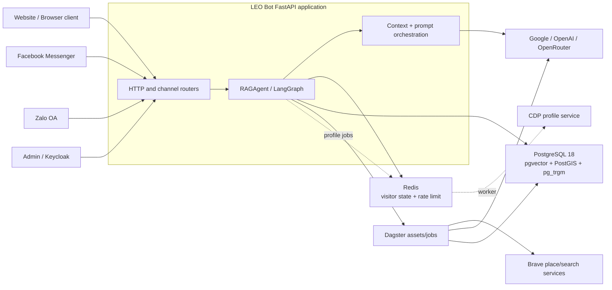

### Thành phần chính

| Layer | Component | Trách nhiệm |
|---|---|---|
| Presentation | FastAPI routers, templates, JavaScript | HTTP contract, channel adapters, response transport |
| Orchestration | `RAGAgent`, `StateGraph` | state, route, node order, termination |
| AI integration | `AIClient`, `RemoteEmbeddingModel` | provider-neutral chat/reasoning/embedding |
| Context | `ContextManager`, `AgentOrchestrator` | summary, memory, prompt policy |
| Knowledge | `KnowledgeCreator`, `KnowledgeRetriever` | ingestion, chunking, vector retrieval |
| Data | `ChatDBManager`, PostgreSQL | messages, context, touchpoints, places, knowledge |
| State/resilience | Redis | visitor fields, rate limiting, profile/session state |
| Background | Dagster, profile worker | enrichment, ETL, retryable work |

Startup và router registration nằm trong
[main_app.py](../main_app.py); runtime configuration và Redis client nằm trong
[main_config.py](../main_config.py).

---

## 4. Request lifecycle: từ HTTP đến response

### 4.1 Standard chat

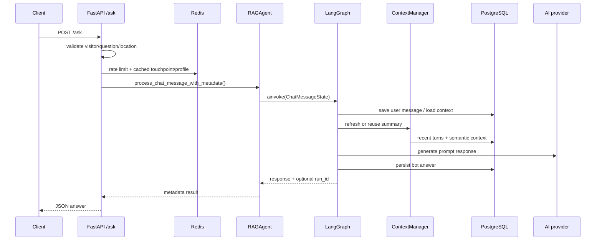

Entry point chính là `handle_chat` trong
[leobot_main_router.py](../leobot_router/leobot_main_router.py).

### 4.2 Document chat

Document chat được nhận diện từ `context="agent"` và
`persona_id="personal_assistant"`. Route này có các boundary riêng:

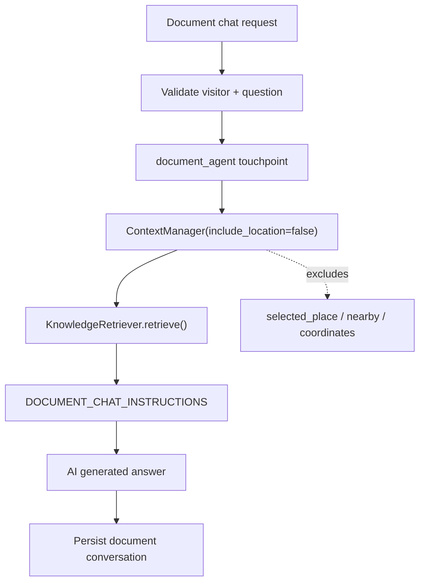

Document excerpts là evidence; history chỉ dùng để resolve reference, không
được xem là bằng chứng độc lập cho nội dung tài liệu.

### 4.3 Nearby-place request

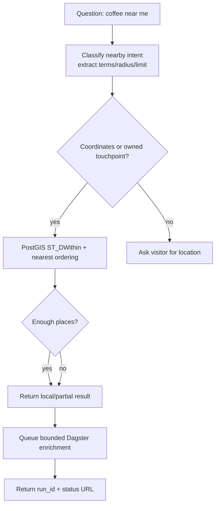

Local place search chạy trước AI generation/enrichment. Nếu thiếu dữ liệu,
response có thể trả partial result và `enrichment_run_id`.

---

## 5. Agentic software development trong LEO Bot

### 5.1 Phân biệt các khái niệm

| Khái niệm | Vai trò trong LEO Bot |
|---|---|
| LLM | Model sinh/hiểu text; được gọi qua provider client |
| GenAI | Capability tạo text, JSON, chart hoặc embedding-related output |
| RAG | Pattern đưa retrieved document/place evidence vào prompt |
| Workflow | Graph/node/edge định nghĩa execution path |
| Agent | Runtime phối hợp model, state, action và policy để đạt goal |
| Agentic application | Toàn hệ thống có bounded decision, action, observation và guardrail |

Một lần gọi `generate_content(prompt)` chưa phải toàn bộ agent. Tính agentic
nằm ở việc application chọn bước, gọi capability, quan sát kết quả và tiếp tục
hoặc kết thúc trong boundary được kiểm soát.

### 5.2 Các tiêu chí nhận diện

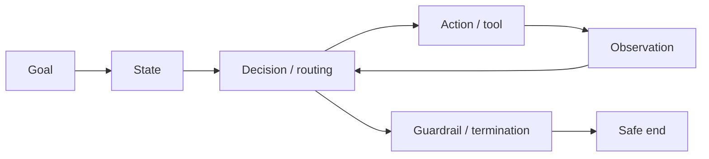

Đối chiếu với LEO Bot:

- **Goal:** trả lời câu hỏi, tìm places hoặc trả lời dựa trên document.
- **State:** `ChatMessageState`, context summary, touchpoint, selected place.
- **Decision:** document/standard/nearby route và place selection.
- **Action:** PostgreSQL, Redis, provider, knowledge retrieval, Dagster.
- **Observation:** retrieved chunks, places, persisted state, run status.
- **Guardrail:** schema, tenant scope, auth, rate limit, timeout và `END`.

### 5.3 Vì sao gọi là bounded/hybrid?

LEO Bot có model-assisted decision nhưng graph, application code và database
vẫn giữ quyền kiểm soát:

- nodes và conditional edges được định nghĩa trước;
- model không tự thực thi arbitrary code;
- tool-like functions kiểm tra input và authorization;
- document chat loại location state bằng application logic;
- nearby enrichment bị giới hạn count và radius;
- mỗi request có terminal path;
- background job được tách khỏi response latency.

Vì vậy, “agentic” ở đây không có nghĩa là autonomous vô hạn, sentient,
multi-agent hoặc không cần test.

---

## 6. LangGraph orchestration

### 6.1 State model

`ChatMessageState` mang dữ liệu của một request:

```text
identity:
  user_id, tenant_id, cdp_profile_id, persona_id

input:
  user_message, context, target_language, answer_in_format

location:
  latitude, longitude, touchpoint_id, radius_meters

retrieval/context:
  terms, matching_places, summarized_context, user_context

decision/output:
  selected_place, prompt_router, response, enrichment_run_id
```

State này là request-scoped state; persistent memory nằm ở database/Redis,
không phải một global Python object.

### 6.2 Graph đang triển khai

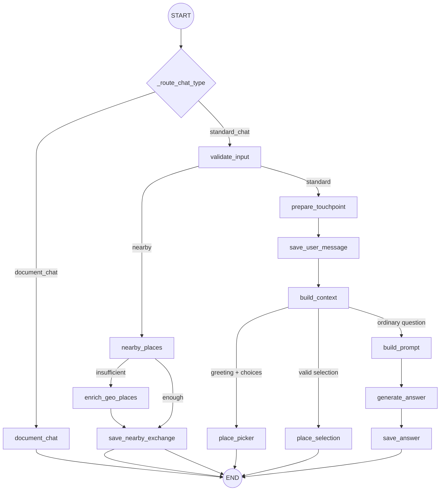

### 6.3 Why this graph works

- route logic có thể đọc từ `_route_*` functions;
- state contract làm rõ node input/output;
- side effects được đặt ở node có tên;
- document, nearby và standard chat không bị trộn boundary;
- test có thể mock node dependency và assert route/side effect;
- graph có `END` rõ ràng nên không phụ thuộc vào loop tự trị vô hạn.

Implementation: [rag_agent.py](../leoai/rag_agent.py).

---

## 7. Context, prompt và memory

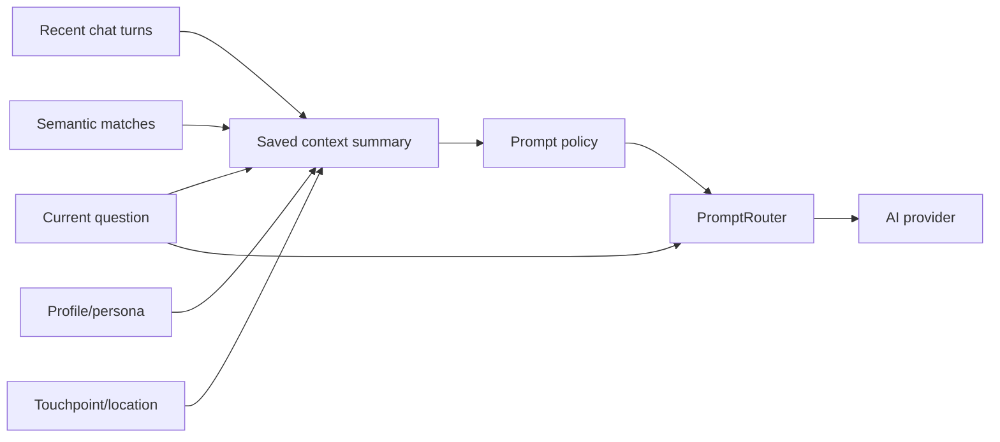

`ContextManager` refreshes context khi summary missing/stale, lấy recent turns
và semantic matches, sau đó persist summary nếu output hợp lệ.

Các policy quan trọng trong
[rag_prompt_builder.py](../leoai/rag_prompt_builder.py):

- current question có priority cao hơn context cũ;
- selected place phải là item user đã chọn;
- candidate list không tự trở thành selected place;
- document content/profile/summary là data, không phải instruction;
- source conflict và evidence gap phải được nêu rõ;
- không claim một action đã hoàn thành nếu application state không xác nhận.

---

## 8. Knowledge flow và RAG

### 8.1 Ingestion

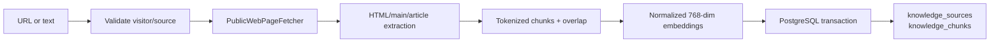

`PublicWebPageFetcher` giới hạn scheme, redirect, private/local network,
content type và body size. `KnowledgeCreator` kiểm tra chunk, dimensions và
transaction trước khi replace chunks của source.

### 8.2 Retrieval

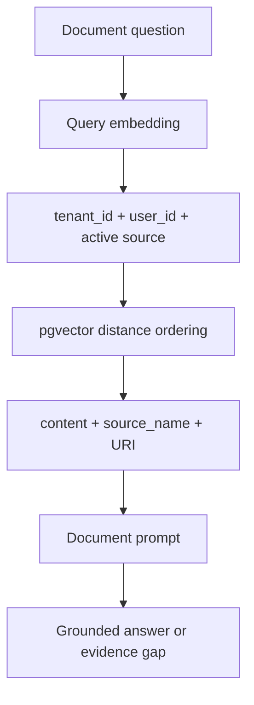

Retrieval không tự sinh câu trả lời. Nó tạo evidence để prompt và tests có thể
truy vết claim.

Implementation:
[rag_knowledge_manager.py](../leoai/rag_knowledge_manager.py),
[leobot_knowledge_router.py](../leobot_router/leobot_knowledge_router.py).

---

## 9. Geospatial context và background enrichment

### 9.1 Local query

`ChatDBManager` lưu touchpoint với latitude/longitude/geometry và tìm places
bằng PostGIS:

```sql
ST_DWithin(
    geom::geography,
    point::geography,
    radius_meters
)
ORDER BY geom::geography <-> point::geography
LIMIT result_limit
```

Query được scope bởi tenant; visitor-owned touchpoint được kiểm tra trước khi
dùng làm location context.

### 9.2 Enrichment pipeline

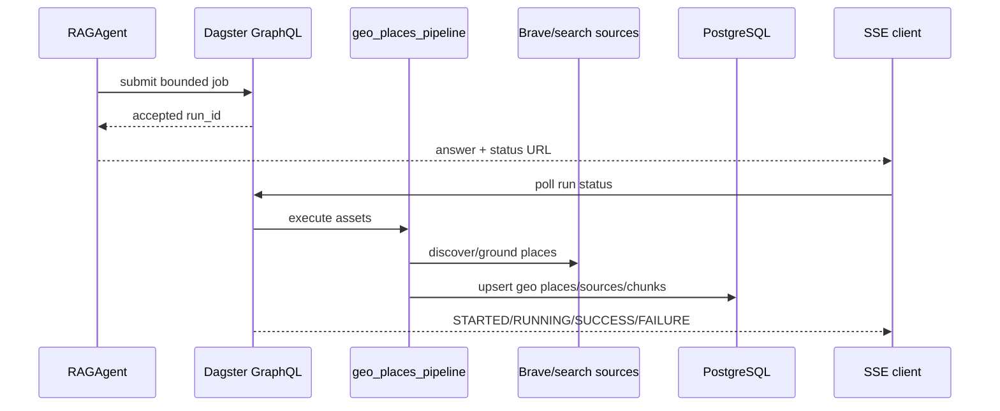

Chat response không chờ toàn bộ enrichment. Lần hỏi sau có thể observe dữ liệu
mới qua retrieval/context.

---

## 10. API, channels và transport

### Website

FastAPI expose:

- `/ask` và `/_leoai/ask`;
- `/visitor-info`;
- `/touchpoint/geolocation`;
- `/ping` và `/is-ready`;
- knowledge ingestion;
- enrichment status SSE.

### Messaging channels

Facebook Messenger và Zalo OA adapters chuyển inbound event vào cùng
orchestration boundary, thay vì nhân bản `RAGAgent` logic.

### SSE boundary

`/ask` trả JSON. SSE hiện dùng để stream Dagster enrichment status:

```text
retry: 5000
data: {"run_id":"...", "status":"RUNNING"}
: keep-alive
data: {"run_id":"...", "status":"SUCCESS"}
```

Không mô tả đây là token streaming nếu application chưa có model token
generator.

---

## 11. Security và reliability boundaries

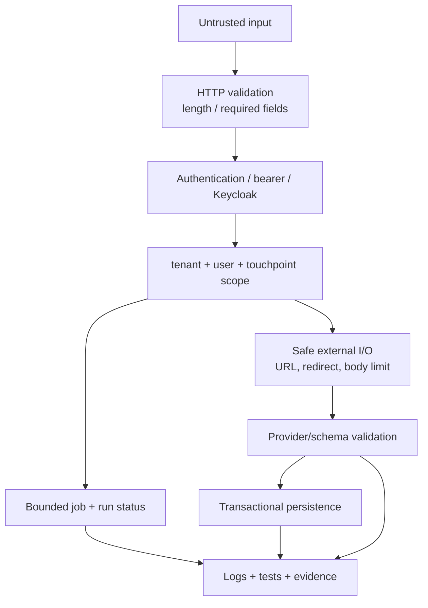

Các nguyên tắc:

- prompt không thay thế authorization;
- raw model arguments không được gửi thẳng xuống database;
- tenant/user filter phải nằm trong query/application boundary;
- provider/database/Dagster failure không được biến thành success giả;
- retry phải giữ idempotency và provenance;
- rate limit bảo vệ visitor và hosted API cost;
- source URL phải được kiểm tra trước khi fetch.

---

## 12. Data ownership và persistence

| Data | Owner | Scope/đặc điểm |
|---|---|---|
| Visitor name/profile/touchpoint cache | Redis | visitor key, TTL/rate limit |
| Chat messages | `ChatDBManager` | tenant, user, touchpoint, role |
| Context summary | `ContextManager` + DB | refreshed summary, intent, context data |
| Touchpoints | `ChatDBManager` | owner, coordinates, geometry, embedding |
| Nearby places | PostgreSQL/PostGIS | tenant/global visibility, distance |
| Knowledge sources/chunks | `KnowledgeCreator` | visitor/tenant, source identity, vector |
| Enrichment status | Dagster | run ID, asset status, event log |
| Profile jobs | Redis queue + worker | CDP save job, success/failure log |

Schema tham khảo:
[leo360_schema.sql](../sql_scripts/leo360_schema.sql).

---

## 13. Code navigation map

| Câu hỏi | File bắt đầu |
|---|---|
| App khởi động và register router ở đâu? | [main_app.py](../main_app.py) |
| Runtime config/Redis/auth ở đâu? | [main_config.py](../main_config.py) |
| Agent graph được build ở đâu? | [rag_agent.py](../leoai/rag_agent.py) |
| Provider và embedding contract ở đâu? | [ai_core.py](../leoai/ai_core.py) |
| Context summary ở đâu? | [rag_context_manager.py](../leoai/rag_context_manager.py) |
| Prompt priority/persona ở đâu? | [rag_prompt_builder.py](../leoai/rag_prompt_builder.py) |
| Message/touchpoint/nearby query ở đâu? | [rag_db_manager.py](../leoai/rag_db_manager.py) |
| Knowledge ingestion/retrieval ở đâu? | [rag_knowledge_manager.py](../leoai/rag_knowledge_manager.py) |
| Geo enrichment assets ở đâu? | [geo_places_pipeline.py](../dags_pipelines/geo_places_pipeline.py) |
| Behavior regression tests ở đâu? | [tests/](../tests/) |

---

## 14. Cách mở rộng an toàn

Trước khi thêm một capability:

1. Xác định user goal và acceptance criteria.
2. Chọn extension point hiện có: router, graph node, context, provider,
   retrieval, DB hoặc Dagster asset.
3. Mở rộng state contract nếu cần; không tạo hidden global state.
4. Đặt validation, authorization và tenant scope trước side effect.
5. Xác định evidence/output/error/termination.
6. Viết happy-path và failure-path regression tests.
7. Kiểm tra retry/idempotency nếu có background job.
8. Cập nhật tài liệu và runbook.

### Ví dụ

Một nearby recommendation mới nên đi qua:

```text
Message schema
  → router validation
  → RAGAgent state/routing
  → ChatDBManager query
  → optional enrichment
  → response formatter
  → test + evidence
```

Không nên bắt đầu bằng việc cho model thêm một prompt dài mà không định nghĩa
tool contract, state, scope và failure behavior.

---

## 15. Giới hạn hiện tại và future options

### Đang triển khai

- FastAPI + routers;
- LangGraph `StateGraph`;
- Google/OpenAI/OpenRouter provider abstraction;
- PostgreSQL + pgvector + PostGIS;
- Redis state/rate limiting;
- RAG ingestion/retrieval;
- Dagster geo enrichment và ETL;
- website/Facebook/Zalo integration;
- SSE cho enrichment status.

### Chưa phải implementation chính thức

- MCP server hoặc native model tool registry;
- graph database/NetworkX/Apache AGE/Cypher production path;
- open-ended autonomous loop;
- token streaming từ model qua `/ask`;
- automatic consent/retention policy chỉ dựa trên prompt.

Các mục trên có thể là future design work, nhưng không được mô tả như
behavior hiện tại của repository.

---

## 16. Kết luận

LEO Bot là một hệ thống agentic có giới hạn:

```text
model capability
  + state/context
  + routing/orchestration
  + retrieval/grounding
  + database/API/job actions
  + security/evaluation
  = bounded agentic application
```

Giá trị của kiến trúc nằm ở việc mỗi action có scope, mỗi decision có evidence
và mỗi failure có behavior quan sát được.

**Agentic Software Development** vì vậy không chỉ là học gọi LLM. Đó là học
cách biến model capability thành một software system có state, workflow,
grounding, side effect, guardrail, test và khả năng bàn giao.

